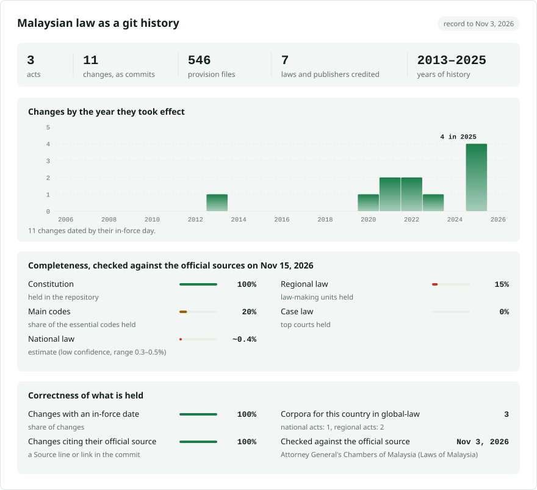

# Malaysia: law history in git

<picture>
<source media="(prefers-color-scheme: dark)" srcset="data/effort-dark.svg">

</picture>

The law of Malaysia as a git history: one file per provision, one commit per change on the day it came into force, and the Act that made each change as the commit's author. `git blame` names the Act behind every paragraph; `git log` lists every change to an Article; picking a date gives the text in force that day.

Part of [lexifina/global-law](https://github.com/lexifina/global-law), one git history for every country's law: this is Malaysia's national law, which global-law reads at `malaysia/national/acts/`.

**What is in it now:** the Federal Constitution (5 versions, 15 October 2020 to 30 November 2025); 671 principal Acts of Parliament (711 versions), each in its current English reprint and, where the portal has them as text, its earlier reprints, or as enacted, among them the Penal Code [Act 574], the Criminal Procedure Code [Act 593], the Contracts Act 1950, the Evidence Act 1950, the Companies Act 2016, the Employment Act 1955 and the National Land Code; the Personal Data Protection Act 2010 with 4 versions; 345 amending Acts (2007 onwards) as enacted; and 6056 instruments of subsidiary legislation (P.U.(A)) as made. [`STRUCTURE.md`](STRUCTURE.md) gives the layout and dating rules.

Each act is a folder with one file per Article or section and Schedule, and a `README.md` listing its provisions (`constitution/art-160.md` is Article 160 of the Federal Constitution; `acts/1950/136-contracts/s-010.md` is section 10 of the Contracts Act 1950 [Act 136]; amending Acts are filed as `acts/<year>/a<number>-<slug>/`, P.U.(A) instruments as `subsidiary/<year>/pua-<number>-<slug>/`); the Employment Act has one file per page of the official reprint.

The text is in English, as the Attorney General's Chambers' official reprints print it. Malay is the national language and its text is published alongside; it is not part of this record.

## Questions as git commands

| Question | Command |
| --- | --- |
| Every change to Article 160 of the Constitution | `git log -p --word-diff -- constitution/art-160.md` |
| Which Act wrote each line of Article 160? | `git blame constitution/art-160.md` |
| Every version of the Constitution, with the day each came into force | `git log --format="%h %(trailers:key=In-force,valueonly,separator=) %an" -- constitution ':!*/README.md'` |
| Article 160 as in force on 1 June 2022 | `python tools/on.py 2022-06-01 constitution art-160` |

**Outside git**, we also host this record publicly, for free:

- **[Ask Claude about Malaysian law](https://global-law.lexifina.com/v1/try_claude?country=malaysia)**: opens Claude with a first question ready.
- **[Ask ChatGPT](https://global-law.lexifina.com/v1/try_chatgpt?country=malaysia)**: the same question in ChatGPT.
- **[Search Malaysian law on our site](https://lexifina.com/law?country=malaysia&q=annual+leave)**: a search for "annual leave", with each provision's text and its versions, no account needed.
- **[Developer REST API](https://global-law.lexifina.com/v1/search_law?query=annual+leave&jurisdiction=malaysia)**: the same search as JSON, with no key. See the [documentation here](https://lexifina.com/api/global-law).

Both assistants read the record through the free Global law connector (MCP, `https://global-law.lexifina.com/mcp`); the first time, the chat gives you the link that adds it. Ask in Malay or in English.

**Host it yourself easily.** All it takes is git and Python, and the tools run on your machine:

```sh
git clone --depth 1 https://github.com/lexifina/global-law && cd global-law
python3 tools/countries.py add malaysia/national/acts
python3 tools/law.py show 2026-01-01 malaysia/national/acts/constitution/art-160.md
```

Opened in Claude Code, Cursor, VS Code or Codex, the clone also starts a local MCP server with the same tools ([MCP.md](https://github.com/lexifina/global-law/blob/main/MCP.md)).

## Dates

Each commit is dated at noon, Asia/Kuala_Lumpur, on the day the change came into force, and carries it in its `In-force:` trailer (royal assent and Gazette publication are in `Enacted:` and `Published:`):

- for the Constitution, the day the 2025 Reprint's NOTES give for each changed provision; for the PDPA, the days the Reprint as at 15 September 2026 lists for each section Act A1727 amended; where an Act names no day, the day after its publication (Interpretation Acts 1948 and 1967 [Act 388], s. 19(1));
- the two Constitution reprints by their own "As at" dates (15 October 2020 and 30 November 2025); the PDPA as enacted by its commencement day, 15 November 2013; the Employment Act's one text by 1 January 2023, the day its latest amendment, Act A1651, came into operation (page 2 of the reprint);
- Act A1656 came into force on 15 December 2021 but received royal assent on 31 May 2022, so its commit is dated before the Act was enacted; Act A1663 section 6 (the Eighth Schedule) came into force later in some States, but the NOTES give 5 October 2022, and that day is used.

Each change is credited to the Act that made it, as the reprint's NOTES name it (`Act A1663 <act-a1663@agc.gov.my.invalid>`). The first text of the Constitution (the 2020 Reprint, the oldest English text online) and the Employment Act's text are credited to the publisher, the Attorney General's Chambers, as are two small differences between the reprints that no Act explains, committed on 30 November 2025 and labelled unexplained.

## How it is checked

- `tools/check_repo.py` reads each of the 10 versions back from git on the day it came into force and on the day before; both must match the corpus (0 mismatches, see [`REPRODUCE.md`](REPRODUCE.md)).
- The Acts applied to the 2020 Reprint must give the Reprint as at 30 November 2025 exactly, apart from the two unexplained changes, and Act A1727 applied to the PDPA its Reprint as at 15 September 2026, word for word.
- Against the official PDFs read a second way: every paragraph of the Constitution and the PDPA (4,558 and 2,224 checks) is found word for word, with 0 misses; the Employment Act's 100 pages match the words and punctuation of the PDF's text layer.
- History is append-only: no merge commits and no rewritten commits (the Acts added on 2026-11-27 are dated by their in-force days, so from that point commit dates go back in time); nothing is dated in the future, and every commit's trailers parse.
- [vulnerabilities/](vulnerabilities/): possible drafting mistakes in this law, found by global-law's detectors and checked by hand. Not run yet.

## What it does not show

- **The Constitution before October 2020.** The English reprints online are those of 2020 and 2025 (the 2006 and 2010 reprints are in Malay only); the NOTES record every amendment back to 1957, but that history is not rebuilt yet.
- **Earlier texts of the Employment Act.** Only its current reprint is here.
- **Acts not yet in force.** The Constitution (Amendment) Act 2025 [Act A1752] and the Constitution (Amendment) (No. 2) Act 2025 [Act A1767] are not applied.
- **Article 119 as the 2020 Reprint prints it.** Its footnotes say Act A1603 section 3 (voting age eighteen) was not yet in force, so until 14 December 2021 this record reads the words they say it replaced ("twenty-one years").
- **Notes and layout.** The reprints' NOTES, footnotes and running heads, orders that change numbers but not words, and the PDPA's long title and enacting words are left out.
- **Earlier reprints of most Acts, subsidiary legislation (P.U.(A)/P.U.(B)), state law and case law** are not here yet. Acts whose PDF is a scan (no OCR is run), Acts whose sections could not be found in order, and amending Acts not yet in force or brought into force on several days are held back. Amending Acts are filed as enacted, not applied to the Acts they amend; each principal Act's reprint is its consolidated text.

## Sources

| Source | Kind | Past versions | Notes |
| --- | --- | --- | --- |
| [Laws of Malaysia](https://lom.agc.gov.my) (Attorney General's Chambers) | Official portal: reprints of the Federal Constitution and principal Acts, amending Acts | reprints only ("As at"): the Constitution 2020 and 2025, Act 709 2023 and 2026; each principal Act's current reprint; amending Acts as enacted | The NOTES and lists of amendments name each amending Act and its day. Online reprints are not the reprints made under section 14 of the Revision of Laws Act 1968, nor copies of the Gazette |

## Licence

See [`LICENSE`](LICENSE). The texts come from the Attorney General's Chambers' Laws of Malaysia portal ("Copyright 2023 by Attorney General's Chambers, Malaysia, all rights reserved"), which lets federal legislation be downloaded at no charge; they are reproduced with that attribution, and the Chambers do not endorse this repository.

No AI model wrote, translated or corrected legal text, and none runs when the history is built; the scripts were written by AI models, and a model read the reprints' NOTES and Act A1727 to list which provisions each Act changed and when (see [`REPRODUCE.md`](REPRODUCE.md)).

## Bahasa Melayu

Repositori ini memuatkan sejarah undang-undang Malaysia dalam git: satu fail bagi setiap peruntukan, satu commit bagi setiap pindaan pada hari ia mula berkuat kuasa, dan Akta yang membuat pindaan itu sebagai pengarang commit. Teksnya ialah teks bahasa Inggeris cetakan semula rasmi Jabatan Peguam Negara (lom.agc.gov.my). Kandungannya kini: Perlembagaan Persekutuan (5 versi, dari Cetakan Semula sehingga 15 Oktober 2020 hingga Cetakan Semula sehingga 30 November 2025), 671 Akta prinsipal dalam cetakan semula bahasa Inggeris semasa atau seperti yang digubal (antaranya Kanun Keseksaan [Akta 574], Kanun Tatacara Jenayah [Akta 593], Akta Kontrak 1950, Akta Keterangan 1950, Akta Syarikat 2016, Akta Kerja 1955 dan Kanun Tanah Negara), Akta Perlindungan Data Peribadi 2010 [Akta 709] (4 versi), 345 Akta pindaan seperti yang digubal dan 6056 perundangan subsidiari (P.U.(A)). `python tools/on.py 2022-06-01 constitution art-160` memaparkan Perkara 160 yang berkuat kuasa pada tarikh itu, dan `git blame constitution/art-160.md` menamakan Akta bagi setiap perenggan.

## Visualisations

- [visualisations/](visualisations/): charts drawn from this repository. Not drawn yet.

## More

From [lexifina/global-law](https://github.com/lexifina/global-law):

- [FEATURES.md](https://github.com/lexifina/global-law/blob/main/FEATURES.md): every feature, and what every corpus must support (`git blame`, `law.py`, the MCP tools)
- [FAQ.md](https://github.com/lexifina/global-law/blob/main/FAQ.md): questions and answers · [CONTRIBUTING.md](https://github.com/lexifina/global-law/blob/main/CONTRIBUTING.md): proposing changes · [MCP.md](https://github.com/lexifina/global-law/blob/main/MCP.md): the MCP server · [REPRODUCE.md](https://github.com/lexifina/global-law/blob/main/REPRODUCE.md): how it was built · [CHANGELOG.md](https://github.com/lexifina/global-law/blob/main/CHANGELOG.md)
- [FRESHNESS.md](https://github.com/lexifina/global-law/blob/main/FRESHNESS.md): how current each corpus is · [Monitoring](https://github.com/lexifina/global-law/tree/main/monitoring): whether updates are running · [WATCHING.md](https://github.com/lexifina/global-law/blob/main/WATCHING.md): how each official source is watched for changes
- [performance/](https://github.com/lexifina/global-law/tree/main/performance): how fast the tools are, measured
- [visualisations/](https://github.com/lexifina/global-law/tree/main/visualisations): charts and bridges across the world's law
- [Vulnerabilities](https://github.com/lexifina/global-law/tree/main/vulnerabilities): mistakes in legislation as published
